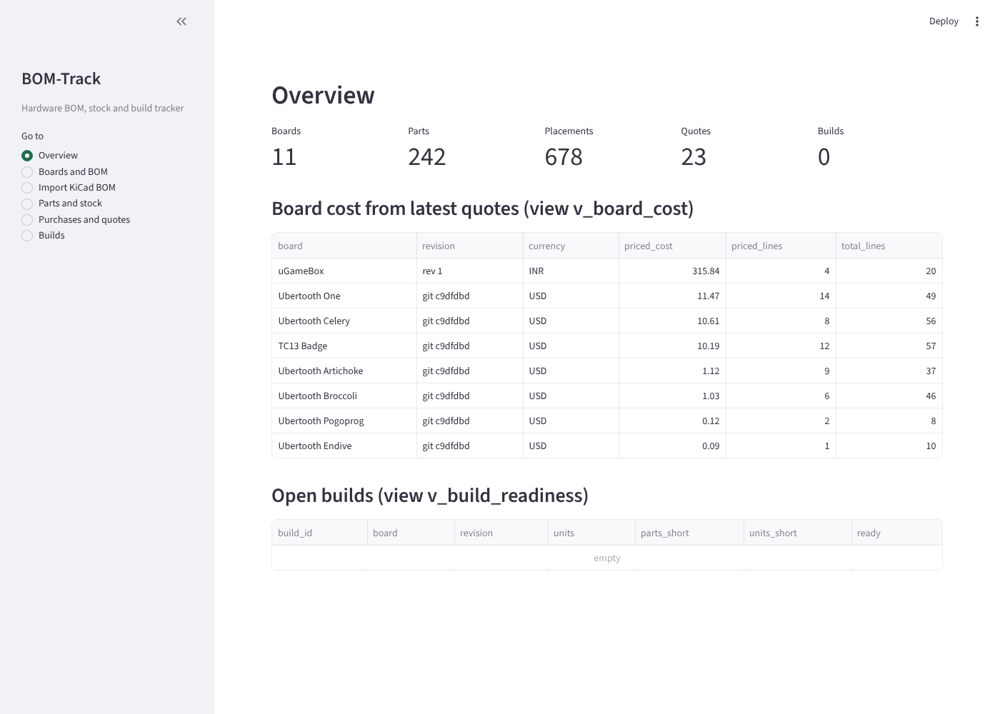

# BOM-Track

Database Systems (BCSE302L) course project: a PostgreSQL database for hardware bills of materials, part stock and board builds.

**Live app:** https://bom-track.streamlit.app

A KiCad BOM export is only a parts list. BOM-Track stores the primitive facts (which part sits where on which board, supplier quotes, stock movements, builds) and lets the **database compute** cost, stock on hand, shortfall and build readiness through SQL views and PL/pgSQL — nothing derived is ever typed in. The data is real: one 8051 board of my own plus ten published open-hardware boards, 678 placed components.



## Run it (Windows, PostgreSQL 18)
```
pip install -r requirements.txt
set PGPASSWORD=<your postgres password>
build_db.bat
python -m streamlit run app.py
```
Linux/macOS: `./build_db.sh`, then `./run_all_demos.sh` to regenerate every log, then `python3 -m streamlit run app.py`.

## Layout
| Path | Contents |
|---|---|
| `sql/01_schema.sql` | 8 tables with keys and constraints |
| `sql/02_views.sql` | 9 views; every derived value |
| `sql/03_plpgsql.sql`, `sql/03b_trg_build_complete.sql` | 2 functions, 3 procedures (1 with cursor), 3 triggers |
| `sql/04_queries.sql` | 17 queries |
| `sql/05_transactions_demo.sql` | 12 demonstration transactions (not real purchases) |
| `sql/06_indexes.sql`, `sql/99_reset_demo.sql` | indexes; remove demo rows |
| `demos/` | concurrency, recovery and indexing demos |
| `logs/` | captured output of everything above |
| `data/raw/` | real BOM files (uGameBox + 10 open-hardware boards) and the 2010 Mouser price file |
| `data/quotes_inr_2026-10-14.csv` | INR prices read from supplier websites, with URLs |
| `tools/` | KiCad schematic extractor, importer, quote loader, browser walkthrough |
| `app.py` | Streamlit front end |
| `docs/` | Review I, II, III documents, viva notes, screenshots |

## Data sources
- uGameBox: own KiCad BOM export.
- Ubertooth family: github.com/greatscottgadgets/ubertooth (git c9dfdbd), hardware/*.
- OtterPill v1.3 and v1.4: github.com/Jana-Marie/OtterPill (git f0e7371).
- ESP32-PoE-ISO Rev N: github.com/OLIMEX/ESP32-POE-ISO (git c19307e).
- Prices: Ubertooth Zero BOM (Mouser, USD, committed 2010-11-04); Probots and Zbotic product pages (INR incl. GST, read 2026-10-14).

Builds and stock movements are only created by using the system. The demo scripts create demonstration rows, which `sql/99_reset_demo.sql` removes.
